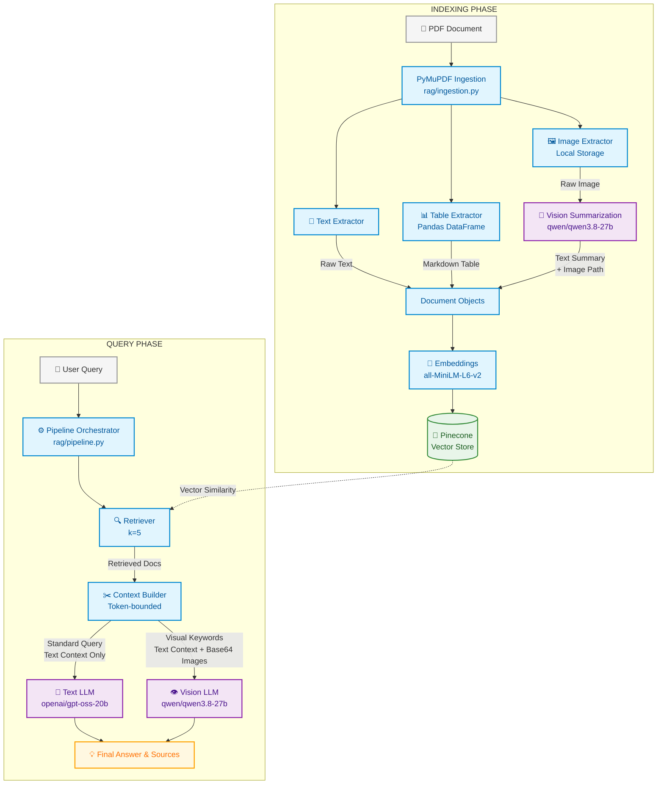

# Multimodal RAG Assistant

A Multimodal Retrieval-Augmented Generation (RAG) system built with Streamlit, LangChain, and Groq. This application allows users to upload PDF documents containing text, tables, and images, and ask questions about the contents. The system extracts diverse modalities, embeds them into a vector space, and uses both text and vision LLMs to provide context-aware answers.

---

## 🏛️ Architecture

The architecture is explicitly designed to handle multimodal data efficiently, strictly splitting into an **Indexing Phase** and a **Query Phase**.



---

## ⚙️ How the Multimodal RAG Pipeline Works

This project is not a standard text-based RAG. It explicitly handles tables and images alongside raw text to preserve complex document semantics.

### 1. Data Ingestion & Parsing
Users upload PDF files via the Streamlit interface (`app.py`), which are temporarily saved and passed to `rag/ingestion.py`. PyMuPDF (`fitz`) iterates through the PDF page by page to extract three distinct modalities concurrently:
- **Text:** Raw text is extracted and stored as a Langchain `Document`.
- **Tables:** Tables are identified using `fitz`, parsed into Pandas DataFrames, and converted to structured Markdown (`df.to_markdown()`). This prevents LLM confusion caused by raw whitespace-separated text.
- **Images:** Images are extracted and saved locally to an `extracted_images/` directory.

### 2. Vision Summarization
To make images semantically searchable, raw images are not embedded directly. Instead, `rag/vision.py` passes each extracted image to a Groq vision model (`qwen/qwen3.8-27b`) during ingestion. The model summarizes the visual information (e.g., extracting values from charts or mapping relationships in diagrams). This text summary becomes the chunk's content, while the local image path is preserved in the metadata.

### 3. Embeddings & Vector Store
The `sentence-transformers/all-MiniLM-L6-v2` HuggingFace embedding model (`rag/indexing.py`) generates vector representations for all chunks (text, markdown tables, and image summaries). These vectors are pushed to a Serverless Pinecone index on AWS `us-east-1`.

### 4. Query Processing & Retrieval
When a user asks a question, the orchestrator (`rag/pipeline.py`) calls the retriever (`rag/retrieval.py`). The Pinecone vector store performs a similarity search, returning the top 5 (`k=5`) most relevant chunks based on the query embedding.

### 5. Context Construction & Token Safety
`rag/llm.py` dynamically builds the prompt context (`build_bounded_context`). Because PDF extractions and Base64 images consume massive token allocations, this step implements a strict "token-bounding" mechanism. It estimates token usage and aggressively truncates or drops chunks to ensure the final payload remains safely under 6,000 tokens.

### 6. Dynamic LLM Routing
To optimize latency and cost, `rag/pipeline.py` intelligently routes the generation task:
- **Vision Pipeline:** If the question contains visual keywords (e.g., "graph", "chart", "image") **and** relevant image paths exist in the retrieved context, it uses `answer_with_vision`. Up to 3 local images are Base64-encoded and passed alongside the text context directly to the Vision LLM (`qwen/qwen3.8-27b`).
- **Text Pipeline:** Otherwise, it falls back to a standard text generation chain using `ChatGroq` with `openai/gpt-oss-20b`.

### 7. Evaluation & Metrics
Every successful query records runtime metrics—including retrieval latency, LLM inference time, total latency, and estimated prompt tokens. These are appended to `rag_metrics_optimized.jsonl`. A built-in dashboard (`rag/evaluation.py`) parses this JSONL file to visualize P50 and P95 latencies and token usage trends.

---

## 📁 Project Structure

```text
multimodal-rag/
├── app.py                         # Main Streamlit application entrypoint
├── requirements.txt               # Python dependencies
├── .env.example                   # Example environment variables
├── rag_metrics_optimized.jsonl    # Logged runtime metrics for evaluation
├── extracted_images/              # Local storage for extracted PDF images
├── utils/
│   └── config.py                  # Static config & environment variables
└── rag/
    ├── ingestion.py               # PyMuPDF extraction (Text, Tables, Images)
    ├── vision.py                  # Groq Vision APIs for image summarization
    ├── indexing.py                # Pinecone & HuggingFace Embeddings logic
    ├── retrieval.py               # Vector similarity search config (k=5)
    ├── llm.py                     # Prompts, context bounding, and LLM chains
    ├── pipeline.py                # Orchestrates retrieval, routing, and generation
    └── evaluation.py              # Streamlit dashboard for evaluating latencies
```

---

## 💻 Installation

1. Clone the repository and navigate into the `multimodal-rag` directory.
2. Create and activate a virtual environment:
   ```bash
   # Windows
   python -m venv venv
   venv\Scripts\activate
   
   # Linux/macOS
   python3 -m venv venv
   source venv/bin/activate
   ```
3. Install the required dependencies:
   ```bash
   pip install -r requirements.txt
   ```
4. Create a `.env` file based on the example and configure your API keys.

## 🔐 Environment Variables

Copy `.env.example` to `.env` and fill in the required keys.

| Variable | Description | Required |
| -------- | ----------- | -------- |
| `GROQ_API_KEY` | API key for Groq (Text & Vision inference) | Yes |
| `PINECONE_API_KEY` | API key for Pinecone vector database | Yes |

*(Note: The Pinecone index name and specific models are statically configured in `utils/config.py`)*

---

## 🚀 Running the Application

Start the Streamlit application using the following command:

```bash
streamlit run app.py
```

---

## 📖 Usage

1. Open the Streamlit web interface.
2. In the sidebar, upload a PDF document.
3. Wait for the processing to finish (text/table/image extraction ➔ vision summarization ➔ embedding ➔ indexing).
4. Once processed, type your questions in the chat input.
5. The assistant will answer using context and cite the relevant pages and modalities. It will also display the retrieved visual images if they were used for generation.
6. To view performance metrics, toggle the **App Mode** in the sidebar to **RAG Evaluation Dashboard**.

---

## 🛠️ Technologies

| Component | Technology |
| --- | --- |
| **Language** | Python |
| **Application Framework** | Streamlit |
| **RAG Orchestration** | LangChain |
| **Document Parsing** | PyMuPDF (`fitz`), Pandas |
| **Embedding Model** | HuggingFace (`sentence-transformers/all-MiniLM-L6-v2`) |
| **Vector Store** | Pinecone (Serverless) |
| **Text LLM** | Groq (`openai/gpt-oss-20b`) |
| **Vision LLM** | Groq (`qwen/qwen3.8-27b`) |
